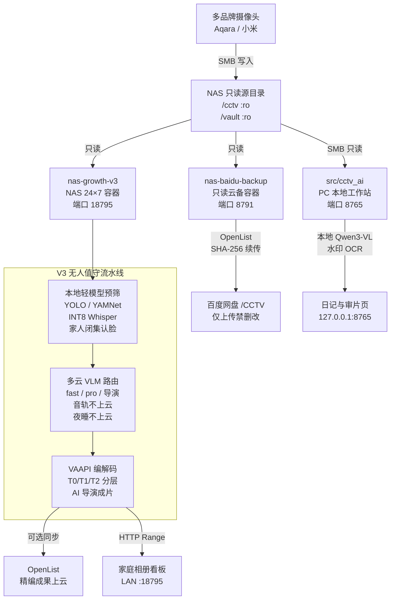

# 家庭监控 AI 成长档案与只读冷备套件 (Family CCTV Growth Archive)

> **隐私优先 · 原始录像 100% 只读 · NAS 24×7 无人值守 + 本地 GPU 精析 + 云端防删冷备**

这是一个面向家庭私有监控录像（NAS 存储的 Aqara / 小米 / 通用 RTSP 归档 MP4）的端到端智能整理与冷备套件，包含三大可独立运行、也可协同配合的核心子系统：

1. **[`nas-growth-v3/`](nas-growth-v3/)（主力生产系统 · 推荐部署）**：专为 NAS Docker 设计的 24×7 无人值守成长档案引擎。负责 P0 当日优先与历史倒序并发处理、三级分层存储（T0 原片 / T1 720p15 互动精华 / T2 1fps 浓缩回顾）、本地轻量模型预筛、多云 VLM 分级路由与容灾、四阶段 AI 导演编排月度/年度成长电影、局域网家庭相册 Web 服务（端口 `18795`）及四重源片防误删安全锁。
2. **[`nas-baidu-backup/`](nas-baidu-backup/)（独立只读云备服务）**：零第三方 Python 依赖的 NAS 百度网盘备份守护进程。通过 OpenList 只写受限账号将原始监控目录只读冷备至百度网盘，内置 SHA-256 断点续传、空文件恢复清单、`Baby_Vault` 优先队列和局域网 Web 控制台（端口 `8791`）。
3. **[`src/cctv_ai/`](src/cctv_ai/)（PC / GPU 本地离线工作流与 V1/V2 引擎）**：适合在配备独立显卡（如 RTX 3090/4090/5090）的局域网工作站上全本地运行。提供摄像头多品牌时间轴适配、宝宝床头不连续 MP4 水印 OCR、YAMNet 声音事件检测与影子校准、Qwen3-VL-8B/32B 原片回读核验、Qwen3-VL-Embedding 自然语言搜图、宝宝生活日记及 `growth_workflow` 有界交互选片剪辑工具。

---

## 系统架构总览



### 仓库目录结构

```text
CCTV/
├── nas-growth-v3/            # ★ V3 无人值守 NAS 容器引擎（核心生产服务）
│   ├── nas_growth/           # 守护进程、导演编剧、人脸护栏、生命周期锁、Web 服务
│   ├── config.example.toml   # V3 主配置模板（复制为 config.toml）
│   ├── compose.example.yaml  # V3 Docker Compose 加固编排模板
│   ├── Dockerfile            # 基于 Python 3.11 + FFmpeg + Intel VAAPI
│   └── README.md             # V3 专项说明
├── nas-baidu-backup/         # ★ 百度网盘只读断点冷备服务（零第三方依赖）
│   ├── backup.py             # 清单扫描、SHA-256 续传、Vault 优先队列
│   ├── dashboard.py          # 局域网状态看板与同源安全控制接口
│   ├── provision.py          # OpenList 只写专用账号初始化工具
│   ├── config.example.json   # 备份配置模板（复制为 config.json）
│   └── compose.example.yaml  # 备份容器编排模板
├── src/cctv_ai/              # ★ PC/GPU 本地离线引擎（CLI、视觉搜索、生活日记、审片剪辑）
│   ├── cli.py                # 统一命令行入口 (cctv-ai)
│   ├── growth_workflow.py    # 有界续跑、人工保留导出与成片剪辑
│   ├── vl_models/            # Qwen3-VL / Qwen2.5-VL / Embedding 适配器
│   └── web_static/           # 本地复核与生活日记静态前端
├── config/                   # PC/GPU 本地配置模板（cameras / models / growth*.toml）
├── scripts/                  # 部署同步、模型导出与 Windows 计划任务脚本
│   ├── deploy_nas_growth_v3.py # 一键增量打包部署 & 配置热重载至 NAS
│   ├── export_nas_models.py    # 导出轻量化 YOLO ONNX / Whisper INT8 模型
│   ├── download_vlm_model.py   # 显式下载本地 Qwen3-VL 权重
│   └── *.ps1                   # Windows 计划任务注册与局域网防火墙配置
├── docs/                     # 架构与迁移设计文档（V2 重构、日记设计、Qwen3-VL 迁移等）
├── tests/                    # 覆盖 V3、本地流水线与 Web 安全的自动化测试套件
├── .env.nas.example          # NAS SSH 部署目标环境变量模板（复制为 .env.nas）
└── pyproject.toml            # Python 包与可选依赖定义 (watermark-ocr / audio-events / web / visual)
```

---

## 核心功能亮点

### 1. `nas-growth-v3/` — NAS 24×7 无人值守家庭成长档案
- **P0 当日优先 + 倒序历史并发回填**：每 15 分钟巡检当日与昨日稳定片段（关闭写入文件 ≥15 分钟、最新活跃文件 ≥90 分钟），保持多日滚动并发推进；一旦检测到当天新稳定片段，立即抢占优先处理，确保“当天看当天”。
- **内存与硬件双保险**：容器内建宿主机 `MemAvailable ≥ 4.0 GiB` 与 cgroup 剩余内存准入检查（`daemon.py`），自动降载并发；优先调用 Intel 核显 `/dev/dri/renderD128`（`h264_vaapi`）加速转码，无硬件加速时平滑回退 `libx264`。
- **三级分层存储与同卷零拷贝**：
  - `T0`：完整入选原片（同文件系统 Btrfs 自动使用 Reflink 零拷贝保留）；
  - `T1`：智能主体裁切后的 `720p15` 互动精华片段；
  - `T2`：`1fps` / 浓缩日夜回顾，夜间床头低运动时段默认自动归档至 `T2`。
- **本地多模态初筛与纯童声隔离**：
  - `YOLO26s ONNX` 人形定位 + 静态区域过滤；
  - `YAMNet TFLite` 音频事件识别 + 基频 `F0 ≥ 310 Hz` 突发段隔离 + 瞬态短生命周期 `faster-whisper`（INT8 CPU 子进程，单次核验完即退出释放全部内存）专门核验清晰的童声“妈妈/妈”“爸爸/爸”；
  - `SCRFD-500M + ArcFace MBF` 闭集家庭成员人脸识别 + 姿态门禁（防后脑勺误匹配）+ 称谓纠偏护栏，避免大模型在日常描述中张冠李戴或使用冰冷的监控术语。
- **多云 VLM 分级路由与严格隐私门禁 (`cloud_vlm.py`)**：
  - 支持 `fast` / `pro` / `director` 三层并发自领任务池（兼容 GCP Vertex AI Service Account JWT、Google Gemini API、OpenAI 兼容网关），单节点限流（429）或配额耗尽自动冷却退避并无缝由同层其他模型接手；
  - **隐私硬边界**：原始音轨全程留存 NAS 本地，永不上传云端；宝宝床头在夜间睡眠时段（可配置 `day_hours`）强制仅走本地计算，永不上传任何帧。
- **四阶段 AI 导演与长周期成片编译 (`daily_director.py` & `film_compiler.py`)**：
  - 自动生成每日图文日记、每日高光短片、月度电影（默认每月 18 日自动编译上月完整周期）、季度成长篇、机位编年史与一周年年度大电影；
  - 支持片头题字、章节胶囊、电影感字幕、尾声寄语，以及逐镜头原片 SHA-256 追溯清单。
- **四重源片防误删安全锁 (`lifecycle.py`)**：
  - 默认处于 `retention_mode = "observe_only"`（**仅观察，绝不删片**）；
  - 只有同时满足「百度首次源片备份 100% 完成 + P1 历史全量归档完成 + 当日全部产出品完整 + 超过 `source_retention_days`」且人工显式开启 `enforce` 时才允许清理超期监控原片；`Baby_Vault` 保险箱目录永久免疫。

### 2. `nas-baidu-backup/` — 独立只读百度网盘备份服务
- **零第三方依赖**：纯 Python 标准库实现，镜像极小（`mem_limit: 256m`、`cpus: 0.5`）。
- **权限最小化**：通过 `provision.py` 为 OpenList 创建仅具备“建目录与上传”权限、**禁止删除/移动/重命名**的专用子账号，容器不挂载 Docker socket。
- **高可靠断点续传**：SQLite WAL 记录文件指纹与已上传 SHA-256；支持 `Baby_Vault` 优先队列、空文件恢复清单（`.cctv-backup-meta/empty-files.json`）、文件稳定期防写残及源文件缺失审计。
- **局域网安全控制台**：端口 `8791`，提供上传速度曲线、目录进度、暂停/继续/重试控制；所有写操作接口强制校验局域网 Host、同源 `Origin` 与专用请求头 `X-CCTV-Control`。

### 3. `src/cctv_ai/` — PC / GPU 本地离线索引与生活日记
- **多品牌相机精确时间轴**：原生适配 Aqara 目录+文件名、`xiaomi_minute` Unix 时间戳，以及**小米床头多段不连续 MP4**（仅靠文件起止时间会跳变，内置固定区域时间水印 OCR 逐段映射真实墙钟时间）。
- **严格稳定双扫入库**：连续两次扫描文件大小与修改时间一致且距最后修改超过 90 分钟才允许进入分析队列，防止读到正在录制的半截文件。
- **完全离线大模型复核与搜图**：配置 `local_files_only=true`，支持 `Qwen3-VL-8B-Instruct`（常规事件与喂养/玩耍/睡眠多帧原片回读确认）、`Qwen3-VL-32B-Instruct`（高价值里程碑复核）及 `Qwen3-VL-Embedding-8B`（中文自然语言搜图，覆盖率达到 95% 后自动平滑替换旧 SigLIP2 索引）。
- **有界交互审片工作流 (`growth_workflow`)**：支持按日期冻结批处理队列、限制本地工作副本上限（默认 20 GB）、导出静态 HTML 原声审片页、导入家长保留标记并无损合并剪辑成片。

---

## 快速开始

### 一、部署 NAS 无人值守成长档案 V3（推荐）

#### 1. 准备 NAS 目录与轻量本地模型
在 NAS 上准备只读录像源与读写归档目录（以 `/volume2` 为例）：
```bash
mkdir -p /volume1/docker/cctv-growth-v3/{conf,secrets}
mkdir -p /volume2/Growth_Archive_V3
```
将离线轻量模型放入 `nas-growth-v3/models/`（可通过本地带显卡/Python 环境的电脑运行 `scripts/export_nas_models.py` 导出并验证等效性）：
- `models/yamnet.tflite` & `models/yamnet_class_map.csv`
- `models/yolo26s.onnx`
- `models/whisper-v3-turbo-int8/`（CTranslate2 INT8 格式）
- `models/face/det_500m.onnx` & `models/face/w600k_mbf.onnx`（可选，启用家庭成员闭集认脸时必需）

#### 2. 配置模板与密钥（权限 `0600`）
```bash
cd nas-growth-v3
cp config.example.toml config.toml
cp compose.example.yaml compose.yaml
```
按实际情况修改：
- **`config.toml`**：设置 `[project]` 中的 `birthday`（宝宝生日）、`p1_start_day` / `p1_end_day`、摄像头 ID 与安装角色、`[[family_members]]` 成员列表，以及 `[vlm.providers.*]` 中你实际拥有的云模型网关。
- **`compose.yaml`**：将 `ports` 绑定 IP 改为你的 NAS 局域网 IP（例如 `192.168.1.100:18795:18795`），确认 `/cctv:ro`、`/vault:ro`、`/data:rw` 挂载路径及当前用户 UID/GID 与 `/dev/dri` 核显设备组权限（通常为 `render` / `video` 组）。
- **`secrets/` 目录**：仅按实际启用的 Provider 放入对应凭证并收紧权限（`chmod 700 secrets && chmod 600 secrets/*`）：
  - `qwen_api_key` / `gemini_api_key` / `cliproxy_api_key`（纯文本 Key）
  - `gcp_vertex_sa_1.json` / `gcp_vertex_sa_2.json`（GCP Service Account JSON）
  - `openlist.json`（格式 `{"username":"...","password":"..."}`，用于同步精编成果）

#### 3. 启动并验证服务
```bash
cp config.toml conf/config.toml
docker compose up -d --build
docker compose logs -f --tail 100
```
验证健康状态与端口：
- 容器健康探针：`curl http://<NAS_LAN_IP>:18795/health.json`
- 家庭相册与实时监控台：浏览器打开 `http://<NAS_LAN_IP>:18795/`

#### 4. （可选）从本地开发机一键增量部署与配置热重载
```bash
cp .env.nas.example .env.nas   # 填入 CCTV_NAS_HOST / CCTV_NAS_USER / CCTV_NAS_GROUP
py scripts/deploy_nas_growth_v3.py
# 仅热更新 config.toml（不重启容器、不中断正在处理的视频）：
py scripts/deploy_nas_growth_v3.py --config-only
```

---

### 二、部署 NAS 百度网盘只读备份（可选）

前提：NAS 上已部署并授权运行 OpenList（挂载好百度网盘）。

1. **创建受限只写账号**（在 NAS 上执行一次，账号仅能建目录与上传，不能删除或改名）：
   ```bash
   cd /volume1/docker/cctv-baidu-backup
   OPENLIST_URL=http://127.0.0.1:5244 python3 provision.py
   ```
2. **复制并调整配置**：
   ```bash
   cp config.example.json config.json
   cp compose.example.yaml compose.yaml
   ```
   编辑 `compose.yaml` 绑定你的 NAS 局域网 IP（端口 `8791`）并确认加入 OpenList 所在 Docker 网络；在 `config.json` 中核对 `expected_source_dirs`、`vault_priority_start` 与 `dashboard_hosts`。
3. **启动与控制台**：
   ```bash
   docker compose up -d --build
   ```
   打开 `http://<NAS_LAN_IP>:8791/` 查看上传进度与速度曲线。首次全量完成后，如需开启每日 `03:30` 自动增量，将 `config.json` 中的 `daily_enabled` 改为 `true` 并重启容器即可。

---

### 三、在 PC / GPU 工作站本地运行（`src/cctv_ai/`）

#### 1. 安装依赖（需要 Python ≥ 3.11 与系统 `ffmpeg`/`ffprobe`）
```powershell
python -m venv .venv
.\.venv\Scripts\Activate.ps1

# 仅基础扫描、媒体探测与 Web 控制台
pip install -e ".[web]"

# 完整能力（含床头水印 OCR、YAMNet 声音分析、本地 Qwen3-VL / YOLO 视觉引擎）
pip install -e ".[watermark-ocr,audio-events,web,visual]"
```

#### 2. 准备配置文件与离线模型
```powershell
copy config\cameras.example.toml config\cameras.toml
copy config\growth_archive.example.toml config\growth_archive.toml
# 编辑上述文件，填入你的 NAS SMB 路径（如 \\192.168.1.100\cctv）与摄像头目录 ID

# 下载本地声音事件模型 (YAMNet)
cctv-ai audio-model-install

# 如需运行本地 Qwen3-VL 视觉分析与自然语言检索（需显式执行下载，运行时强制离线）
python scripts\download_vlm_model.py --role vision-language
python scripts\download_vlm_model.py --role embedding
```

#### 3. 常用命令示例
```powershell
# 1) 扫描与探测（连续两次扫描且稳定超过 90 分钟才会进入可处理状态）
cctv-ai scan --config config\cameras.toml --since 2026-01-01
cctv-ai probe --limit 100

# 2) 本地声音事件检测 + 床头水印时间校准（仅在需要时调用 GPU CUDA）
cctv-ai audio-run --db .data\cctv_index.sqlite3 --root "\\<NAS_LAN_IP>\cctv" --limit 20
cctv-ai watermark-run --db .data\cctv_index.sqlite3 --root "\\<NAS_LAN_IP>\cctv" --hwaccel cuda --limit 5

# 3) 启动本地生活日记与事件复核 Web（仅限本机与家庭可信子网访问）
cctv-ai serve --root "\\<NAS_LAN_IP>\cctv" --host 0.0.0.0 --port 8765 `
  --allowed-network 127.0.0.0/8 --allowed-network ::1/128 --allowed-network 192.168.1.0/24

# 4) 有界成长片审片与剪辑工作流（growth_workflow）
python -m cctv_ai.growth_workflow plan --batch output\growth-sample --since "2026-07-01T00:00:00+08:00" --until "2026-07-08T00:00:00+08:00"
python -m cctv_ai.growth_workflow run  --batch output\growth-sample --limit-files 20 --max-cache-gb 20
python -m cctv_ai.growth_workflow serve --batch output\growth-sample --port 18791
```
如需在 Windows 上开机自启后台索引、视觉回填与局域网 Web 服务，可使用 `scripts/install_startup_tasks.ps1` 与 `scripts/enable_review_lan_firewall.ps1`（均从本地 `config\cameras.toml` 动态读取根路径与摄像头列表）。

---

## 部署建议（生产实战指南）

### 1. 三种典型部署拓扑选型

| 方案 | 推荐硬件配置 | 核心运行模块 | 隐私与网络特点 | 适用家庭场景 |
|---|---|---|---|---|
| **方案 A：NAS 24×7 主力版（推荐）** | x86 NAS（Intel N100 / Pentium 8505 或带核显机型）、**≥16 GB 内存**、Btrfs 存储池 | `nas-growth-v3` + `nas-baidu-backup` | 原片与音轨全本地；仅白天日间关键帧抽样走加密 HTTPS 发往自选云 VLM；功耗低（15–30W） | **绝大多数家庭首选**：省电静音、当天录当天出片、零手动干预 |
| **方案 B：极致隐私零上云版** | NAS（纯存储） + 局域网工作站（**RTX 3090/4090/5090 24GB+ 显存**、2.5GbE 有线内网） | `src/cctv_ai` 全套本地流水线（Qwen3-VL / MiniCPM-V / Whisper） | **100% 数据不出局域网**，无任何云 API 开销；电费与显卡噪声较高 | 对云端视觉分析完全零容忍、且已有大显存独显主机的极客用户 |
| **方案 C：混合黄金架构** | 上述 NAS + 局域网 PC 按需开机 | NAS 跑 `nas-growth-v3`（日常）+ `nas-baidu-backup`；PC 负责 `export_nas_models.py`、高难片段本地复核与离线精剪 | 兼具 24×7 自动化体验与本地大算力回溯能力 | 有数 TB 历史积压、需要做全量本地精细检索或模型对照调优 |

### 2. 硬件资源、存储规划与防误删建议
1. **内存安全线（极为关键）**：
   - NAS 主机若同时运行 Docker 相册、OpenList、备份等服务，建议物理内存 **≥ 16 GB**。
   - `nas-growth-v3` 默认将容器内存限制为 `4096m`，并在调度器中设定宿主机 `MemAvailable < 4.0 GiB` 自动暂停重任务、ASR 子进程运行前需 `≥ 4.25 GiB` 可用内存且运行完毕立即释放进程，防止在低内存 NAS 上触发 OOM 连带拖垮存储服务。
2. **Btrfs 同卷部署加速零拷贝**：
   - 尽量把源目录（`/volume2/CCTV`、`Baby_Vault`）与 V3 归档目录（`/volume2/Growth_Archive_V3`）放在**同一个 Btrfs 存储卷**下。这样生成 `T0` 精选留存原片时自动启用 Btrfs Reflink，**秒级完成且几乎不占用额外磁盘空间**。
3. **Intel 核显 VAAPI 硬解权限**：
   - 启动 `nas-growth-v3` 前在 NAS SSH 执行 `ls -ln /dev/dri`，确认 `renderD128` 对应的 GID 与 `compose.yaml` 中 `group_add` 一致（例如常见为 `105` 和 `44`），否则 VAAPI 初始化失败会退回 CPU 软解导致 CPU 满载。
4. **3-2-1 备份与清理守则**：
   - 所有容器对原录像目录必须保持 **`:ro` 只读挂载**；
   - 将出生首年或高价值时期的重要机位单独镜像或隔离一份至 `/volume2/Baby_Vault`；
   - 在亲自验证「百度网盘首次全量完成 + 随机下载几个大文件核对 SHA-256 与原片一致 + 历史全量归档完毕」之前，务必保持 `[lifecycle].retention_mode = "observe_only"`。

### 3. 网络安全与家庭隐私加固
- **严禁公网端口转发**：Web 控制台（`18795` / `8791` / `8765`）定位为家庭内网服务，默认未设复杂账号体系。请在路由器上关闭对应端口的 UPnP / 端口映射，在 `compose.yaml` 中使用 `<NAS_LAN_IP>:PORT:PORT` 显式绑定内网 IP。
- **远程访问方式**：如需在外网手机看宝宝成长日片，建议通过 **Tailscale / WireGuard / 路由器内置 VPN** 接入家庭内网后访问，不要直接把端口暴露在公网。
- **最小权限与密钥隔离**：
  - `secrets/` 目录严格设置为 `0700`，密钥文件 `0600`，仅以 `:ro` 挂载进容器 `/run/secrets/`；代码与 SQLite 日志内置 `redact_secrets` 脱敏，不记录任何 Key；
  - 容器强制开启 `read_only: true`、`cap_drop: [ALL]`、`no-new-privileges:true` 与非 root UID 运行，仅 `/data` 与 `/tmp`（tmpfs）可写。
- **夜间与音频隐私门禁**：床头摄像头在 `[cameras.xxx].day_hours` 之外（如夜间睡眠时间）会被代码硬性拦截，绝不将画面发送给任何云端 VLM；原始音频始终只在 NAS 本地解码特征，不上云。

### 4. 云端 VLM 成本与配额控制建议
- **分层用模型**：日常海量片段用 `fast` 层（如 Flash / Max 级高性价比模型）+ `max_image_edge = 768` 控制视觉 token；仅筛出的高光片段与月度编剧才进入 `pro` / `director` 层。
- **多通道并发与防雪崩**：在 `config.toml` 中配置 2 个以上独立 Provider（例如主订阅配额 + 备用 API/Vertex 试用赠金）。当某家触发 429 或配额耗尽时，任务会自动退回队列并让该 Provider 冷却（`rate_limit_cooldown_seconds` / `quota_cooldown_seconds`），其余健康通道会无缝接管。
- **理性看待机器召回率**：VLM 与检测模型输出始终只是“回看线索”，存在漏检与误判边界，**任何情况下都不要将 AI 判断“未发现宝宝/无事件”作为删除原片的依据**。

### 5. 上线与日常运维验收清单
- [ ] `docker inspect cctv-growth-v3` 显示状态为 `healthy`，`OOMKilled=false`，`Mounts` 中 `/cctv` 与 `/vault` 为 `ro`。
- [ ] 访问 `http://<NAS_LAN_IP>:18795/api/status` 正常返回 JSON，宿主机 `MemAvailable` 稳定高于 4 GiB。
- [ ] 日志中确认 `[VAAPI]` 硬件编码探测通过，且连续运行 1 小时无异常退出或解码僵死。
- [ ] `sqlite3` 每日自动在线备份正常落盘，且可通过局域网浏览器顺畅播放分段 Range 视频。

---

## 自动化测试

本地已内置覆盖文件稳定性、防误删安全锁、VLM 路由冷却、家庭人脸称谓护栏、ASR 内存隔离、成片编译及局域网安全边界的完整单测与回归测试：

```powershell
# 运行主套件与 V3 全部自动化测试（无需真实 NAS 或外部 API，缺失本地 config.toml 时自动回退至示例模板）
$env:PYTHONPATH = "src;nas-growth-v3"
pytest -q

# 运行百度备份模块测试
$env:PYTHONPATH = "nas-baidu-backup"
python -m unittest discover -s nas-baidu-backup -p "test_*.py" -v
```

---

## 数据边界与免责声明

1. **原始录像绝对只读**：本项目核心模块不提供静默删除监控原片的快捷开关；所有生成缓存与成片均写入独立归档目录。
2. **非医疗与非安防结论**：AI 自动生成的喂养估计、睡眠区间、姿态里程碑或哭声提醒仅基于摄像头可见/可听范围，受遮挡、视角与动态录像触发限制，**不构成医疗、发育评估或安全看护结论**。
3. **第三方接口与合规**：接入外部多模态大模型或云盘服务时，请自行评估服务商的数据使用条款与家庭隐私边界。
